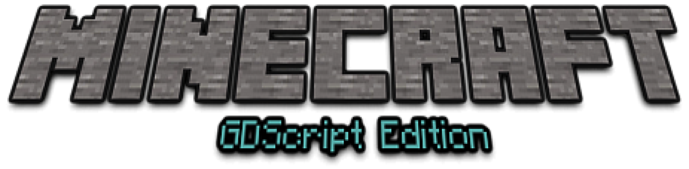

AI has been used to code this project in its entirety. If you have strong feelings about the matter, you don't have to use it at all. This is purely a proof of concept to show that if Claude Code can generate a feature-complete Minecraft: Java Edition clone in a week, the hundreds of Mojang devs could rewrite Minecraft in GDScript or Rust just as easily. Xbox and Microsoft just don't pay them enough or care enough to go through with it.

This project was inspired by Horizon, the Rust Minecraft remake. It ran so well that I wanted to try it in my favourite game engine, Godot. And it worked great, even beating vanilla Minecraft in frame rate and frame time.

Mojang is lazy, and this just proves it more. It would be cool to see this become a trend of people recreating Minecraft to bully Mojang into fixing their own slopfest of technical debt that is Minecraft: Java Edition and Bedrock Edition.

I do not take credit for any of this code, as it is 100% AI. Please do not harass me or anyone involved. Once again, this is just a proof of concept, and I do not massively support AI usage as a whole.

---

# Recraft 2

Recraft 2 is a recreation of Minecraft: Java Edition 26.3 in the Godot 4.7.2 engine, written in typed GDScript with a
C++ GDExtension (RecraftNative) for the hot paths: chunk meshing, lighting, terrain density and feature placement.

It ships **no Mojang or Microsoft content**. If you own Minecraft: Java Edition 26.3, Recraft 2 reads the textures,
models, sounds, language files and game data from **your own installation** at runtime. Without one it runs in
**Original Placeholder Mode** with its own simple procedural textures and blocks.

## Features

- **World generation driven by your 26.3 data**: the overworld, the Nether and the End, with biomes, caves, aquifers,
  ores, trees, features and structures generated from the jar's worldgen JSON (Java's random sources and noise).
- **Game modes**: Survival, Creative, Adventure, Spectator and Hardcore.
- **Blocks, items, recipes and loot tables** from the 26.3 data, plus crafting, smelting, enchanting, brewing,
  trading, redstone, fluids, farming, archaeology and the rest of the survival loop.
- **Mobs** built from Java's model layouts, with their AI, pathfinding and animations, and the Ender Dragon fight.
- **Commands** with Java-style suggestions (`/give`, `/tp`, `/locate`, `/place`, `/execute`, ...).
- **Java-matched presentation**: menus and HUD, fog, sky and lighting, block and item rendering, particles and weather.
- **Multiplayer over LAN**.
- **Performance**: a custom RenderingDevice terrain renderer on Godot's Forward+ pipeline and multithreaded chunk
  generation, aimed at very high, stutter-free frame rates.

Recraft 2 is a work in progress. Open issues are tracked in [PROGRESS.md](PROGRESS.md); fixed ones are in
[fixed.md](fixed.md).

## Requirements

- Windows on ARM64 (native) or x86_64.
- [Godot 4.7.2](https://godotengine.org/) (standard build) to run from source.
- Optional: Minecraft: Java Edition **26.3** installed through the official launcher, for the vanilla assets and data.

## Running

1. Open the project folder in Godot 4.7.2 and press Play, or run `godot --path <project folder>`.
2. On first start the game looks for the Minecraft launcher folder (`%APPDATA%\.minecraft`). If it finds version
   26.3, it asks before reading it. A custom Minecraft folder can be set in Options.
3. Without a Minecraft installation, choose **Placeholder Mode**.

Controls are the Java Edition defaults and can be rebound in Options → Controls. See
[docs/USER_GUIDE.md](docs/USER_GUIDE.md) for the full guide.

## Building

- **Release builds**: use the `Windows ARM64` and `Windows x86_64` export presets, for example
  `godot --headless --path . --export-release "Windows ARM64" build/windows-arm64/Recraft2.exe`.
- **Native library**: prebuilt DLLs for both architectures are in `native/bin/`. To rebuild them (MSVC required):
  `powershell -ExecutionPolicy Bypass -File tools/build_native.ps1 -Arch arm64|x86_64|all`.
- **Checks and tests**: `powershell -ExecutionPolicy Bypass -File tools/check.ps1` compiles every script;
  `godot --headless --path . -- --test` runs the test suite (add `--vanilla` for the tests that use your 26.3 data).

## Project layout

| Folder | Contents |
|---|---|
| `scripts/` | Game code: core registries, world generation, gameplay, entities, UI |
| `shaders/` | Terrain, entity, sky, particle and weather shaders |
| `native/` | RecraftNative C++ GDExtension sources (`src/`) and prebuilt DLLs (`bin/`) |
| `scenes/` | Main scene and the test runner |
| `tools/` | Build, compile-check, benchmark and profiling scripts |
| `docs/` | User guide, status, parity notes and benchmarks |

## Credits

- Designed by Claude Code under bayanalan on GitHub
- Logo designed by textcraft.net
- Prompt design by ChatGPT

Recraft is not an official Minecraft product. It is not approved by or associated with Mojang or Microsoft.
Game assets and text are read at runtime from your own Minecraft 26.3 installation.
Minecraft is a trademark of Mojang Synergies AB / Microsoft.
